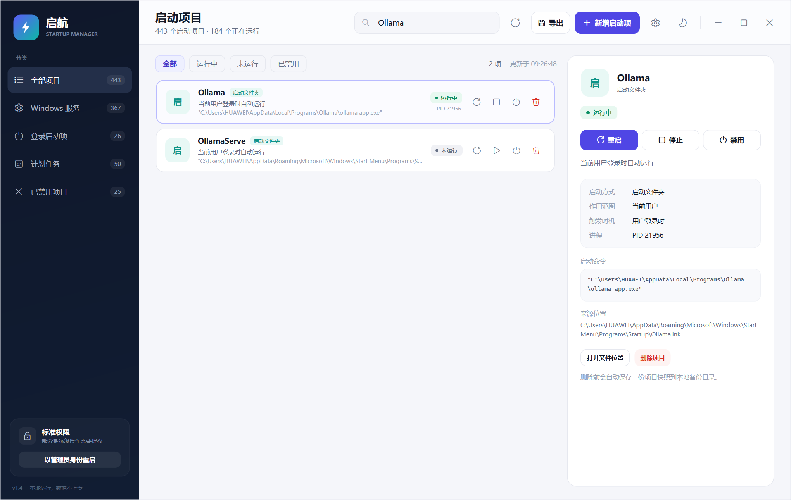
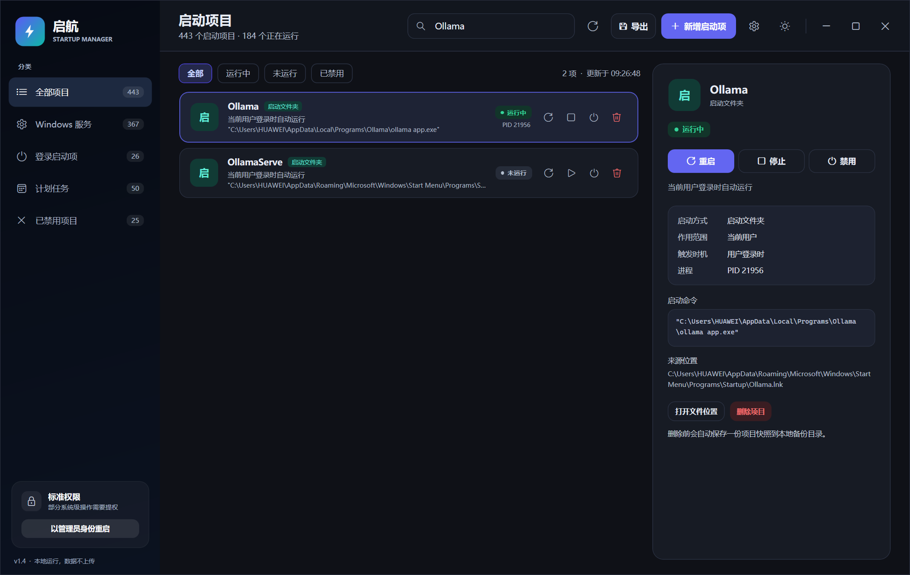
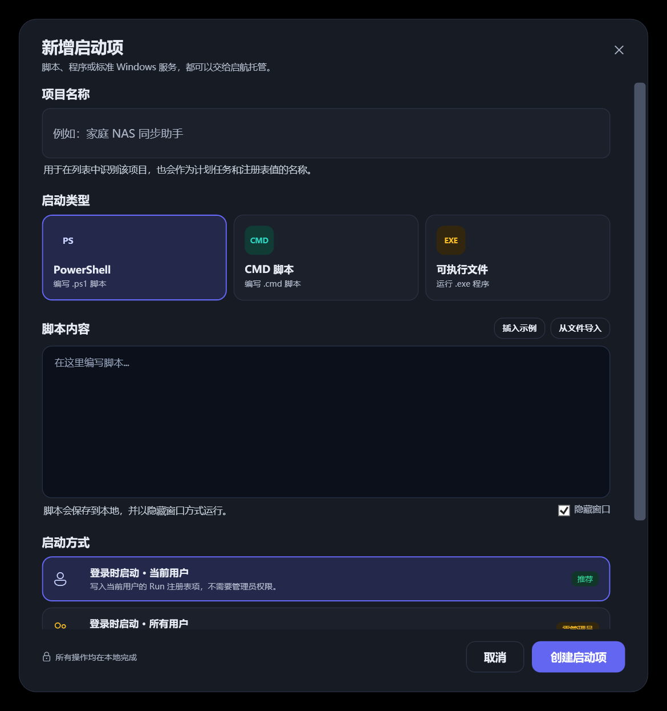
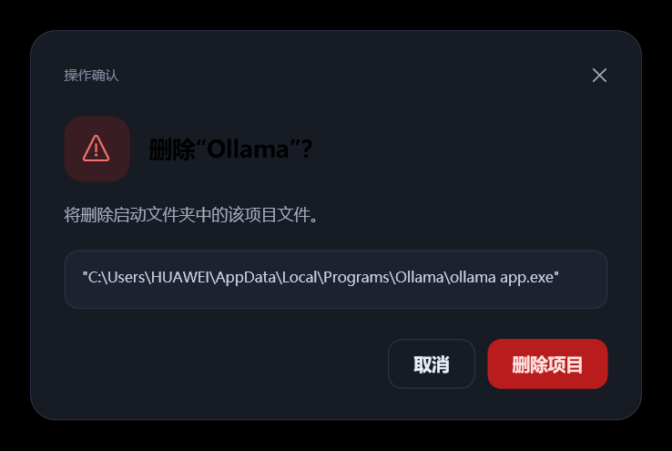
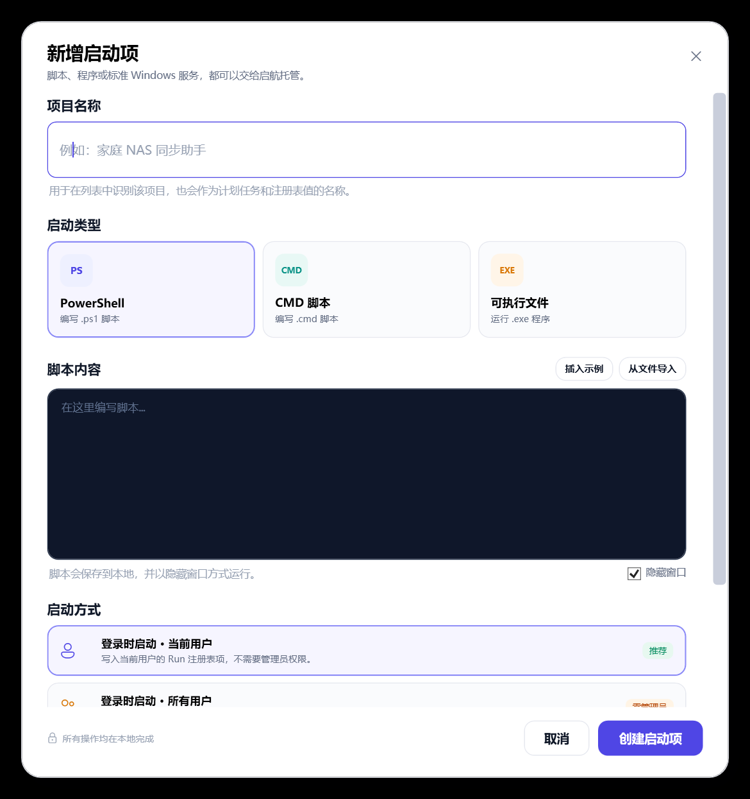
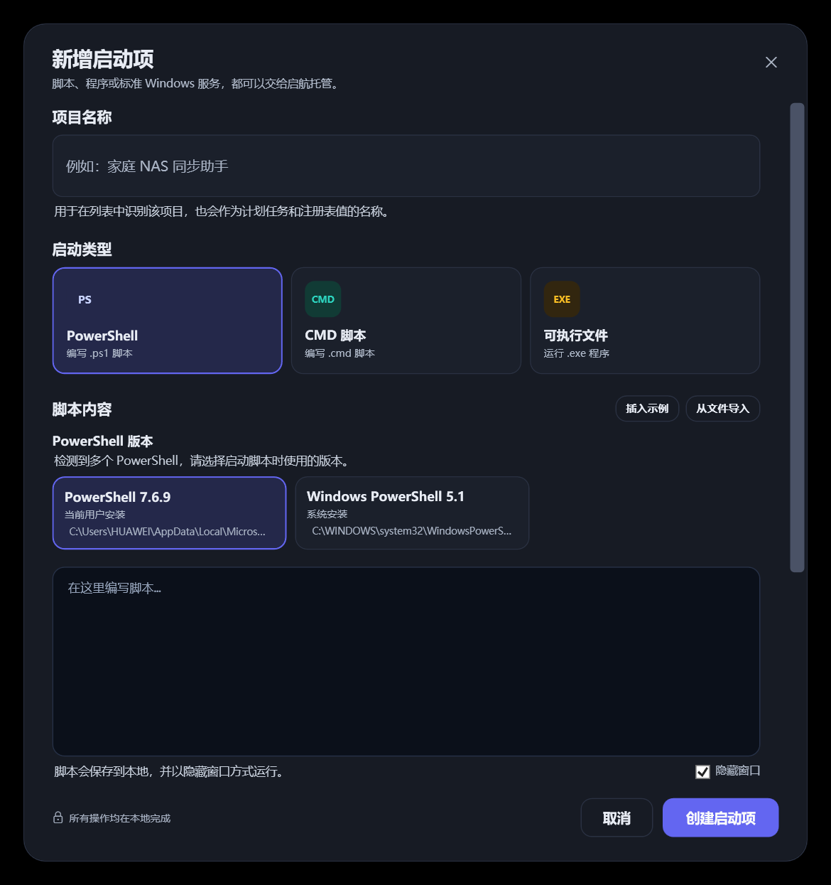
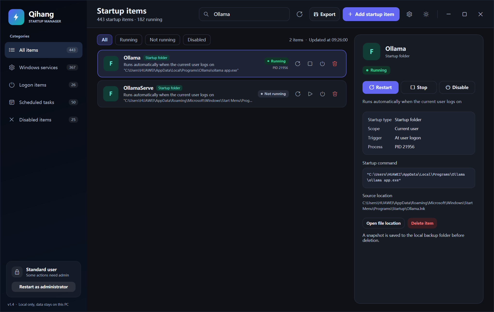
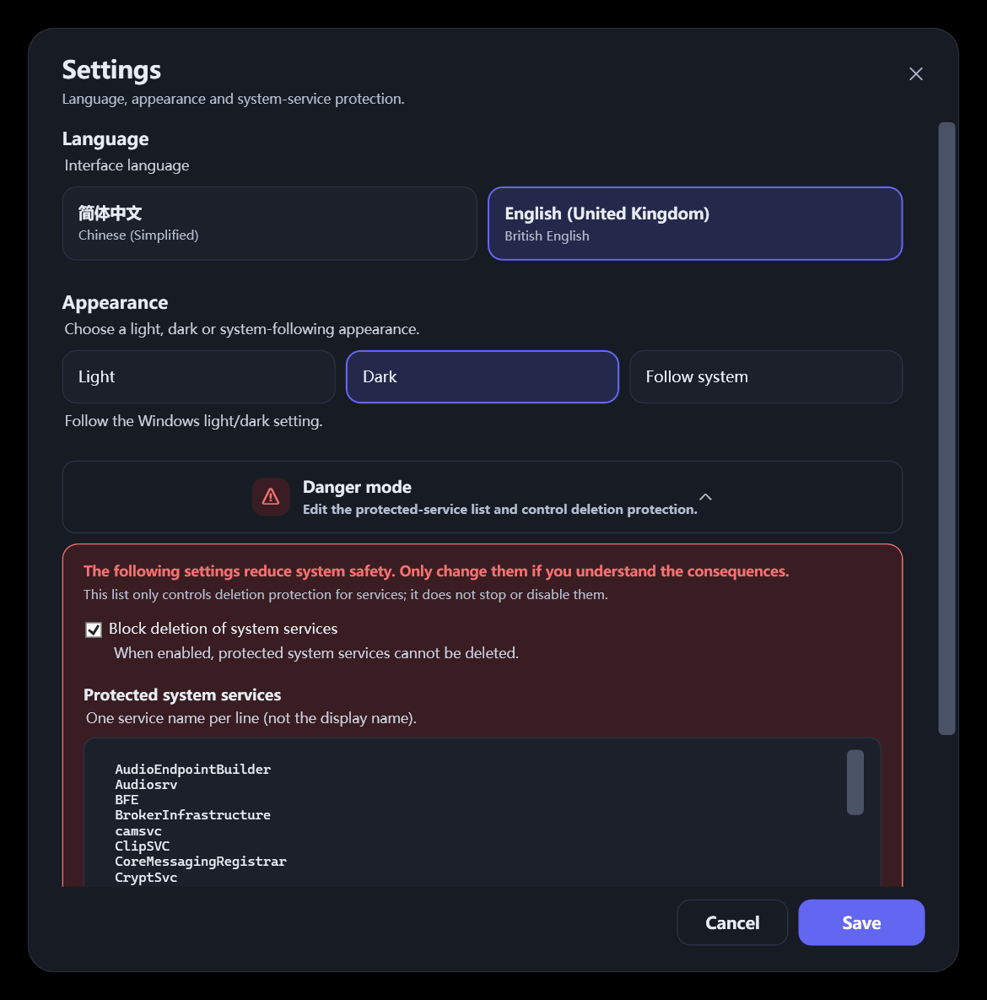
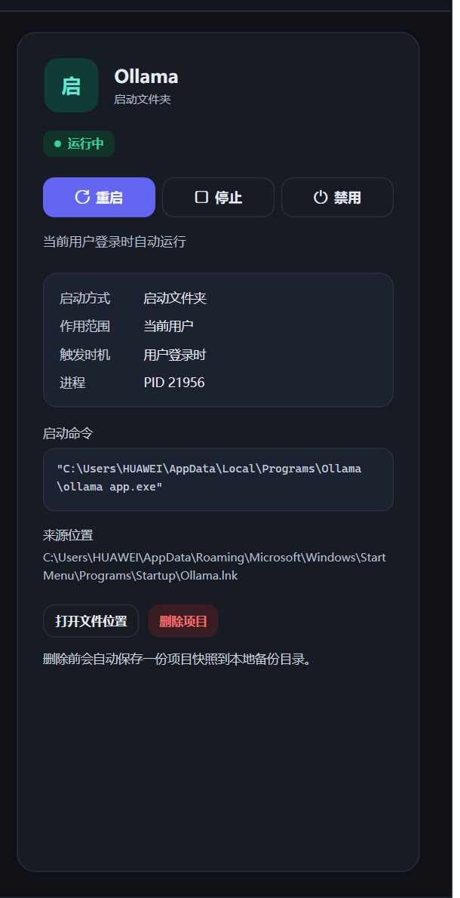

[简体中文](README.md) | English

# Qihang · Startup Manager

A local startup-item management tool for Windows 10/11. It brings autostart entries scattered across **Windows services, registry Run keys, Startup folders and scheduled tasks** together into one interface, and provides stop, restart, enable, disable, delete, add, settings, language switching, light/dark/system appearance, Danger Zone protection and CSV export.

## Theme preview

Light mode:



Dark mode:



<details>
<summary>Add and confirmation dialogues in dark mode</summary>





</details>

## Features

### 1. Unified scan

On startup, the app reads four sources in parallel:

| Source | Description |
| --- | --- |
| Windows services | Enumerates Win32 services through SCM and shows startup type, state, PID and image path |
| Registry startup items | HKCU/HKLM, Run/RunOnce, 32-bit Wow6432Node and Policies entries |
| Startup folders | Current-user and all-users Startup folders, with `.lnk` shortcut resolution |
| Scheduled tasks | Shows only tasks with a boot or logon trigger, retaining task path and execution account |

The list shows runtime state, PID, startup method, scope, administrator requirement, and supports name/command/path search and status filters.

### 2. Stop / End

- **Windows service**: sends a stop request through Service Control Manager and waits for the state to become Stopped, rather than abruptly ending `svchost.exe`.
- **Scheduled task**: asks Task Scheduler to stop the currently running instance.
- **Registry / Startup-folder item**: matches associated processes by executable path and script command line, then ends the process tree.

### 3. Restart

- **Service**: stops the service, waits for it to stop, then starts it and waits for Running.
- **Scheduled task**: ends a running instance and re-triggers the task.
- **Ordinary startup item**: ends associated processes and re-runs the configured command or shortcut.

### 4. Enable / Disable startup

- **Windows service**: changes the service startup type to Disabled without immediately ending the current process; when re-enabled, the original startup type (Automatic/Manual) is restored first. The original startup type is recorded locally and survives an application restart.
- **Registry Run**: writes the enabled/disabled state to `Explorer\StartupApproved\Run` / `Run32`, matching Task Manager behaviour.
- **Startup-folder item**: writes to `Explorer\StartupApproved\StartupFolder` so it no longer starts automatically at the next logon.
- **Scheduled task**: sets the task's `Enabled` state directly, disabling or restoring its triggers; a running instance is not forcibly ended.
- **Critical Windows services**: disabling is blocked to avoid rendering the system unbootable; if such a service has already been disabled externally, the app still allows it to be re-enabled.
- **RunOnce / Group Policy startup items**: the action is disabled with an explanation because Windows does not guarantee that StartupApproved applies to them.

Disabling means “it will not start automatically at the next startup”. It does not automatically end currently running processes.

### 5. Delete

- Deletes registry startup values, Startup-folder files, scheduled tasks or Windows services.
- Saves a local JSON snapshot before deletion for troubleshooting.
- Deleting a Windows service requires retyping the service name; critical services are covered by a built-in protection list.
- System tasks whose path is under `\Microsoft\` also require the task name to be retyped.

### 6. Add startup item



Three content types are supported:

- **PowerShell script**: write it in the editor or import a `.ps1` file; it is saved as a UTF-8 with BOM script.
- **CMD script**: write or import `.cmd`/`.bat` files.
- **Executable**: choose an `.exe` and optionally add startup arguments.

If multiple PowerShell installations are detected (for example Windows PowerShell 5.1 and PowerShell 7.x), selecting the PowerShell type displays version-selection cards:



- The detected version, installation scope and executable path are shown.
- The “Current user” startup mode can use a per-user PowerShell Core installation.
- “All users” and “System startup task” show only machine-wide installations, so `pwsh.exe` under a user profile cannot be missing in another account or a SYSTEM session.
- CMD / EXE types do not show this section; when only one PowerShell is available it is selected automatically without extra friction.

Four startup modes are supported:

| Startup mode | Location | Privileges |
| --- | --- | --- |
| Start at logon · Current user | HKEY_CURRENT_USER `Run` | Standard user |
| Start at logon · All users | HKEY_LOCAL_MACHINE `Run` | Administrator |
| System startup task · SYSTEM | Task Scheduler boot trigger | Administrator |
| Install as a Windows service | SCM creates an automatic-start service | Administrator, EXE only |

> Ordinary desktop programs usually do not implement the Windows service interface and may fail with error 1053 after installation. Such programs should use “Start at logon” or “System startup task” instead.

### 7. Settings menu

Click the gear button on the right side of the header to open Settings:


- **Language**: Simplified Chinese / English (United Kingdom), using British spelling (Minimise, Maximise and so on); the main window, dialogues and operation prompts update immediately.
- **Appearance**: Light / Dark / Follow system. Follow system reads `AppsUseLightTheme` and refreshes when the system appearance changes.
- **Danger Zone** (shown as “Danger mode” in the app): collapsed by default. Expand it to customise the protected system-service list and to choose whether to refuse deletion of system services.

English interface (English (United Kingdom)):



Expanded Danger Zone:



- Enter one **service name** per line (not a display name); changes take effect after clicking Save.
- **Refuse deletion of system services** is enabled by default; when disabled, the protection marker remains but deletion is allowed after retyping the service name.
- The default list protects critical services such as RpcSs, DcomLaunch, Winmgmt, EventLog and WinDefend.
- Danger Zone settings affect deletion protection only. They never stop, disable or modify a service.

### 8. Dark / light appearance

The theme button is on the right side of the header, to the left of the window controls; its icon switches between a moon and a sun:

- All colours are referenced through `DynamicResource`, so switching does not require restarting the window.
- The main window, list, details panel, toast, `AddEntryWindow`, `SettingsWindow` and `ConfirmDialog` retheme together.
- Small text in the details panel (field names, description, command and source) uses light-theme text colours, with a minimum contrast of approximately 6:1 in dark mode; no black text is used.
- The theme preference is saved to `%LOCALAPPDATA%\StartupManager\settings.json` and applied automatically on the next launch.
- The dark theme uses dark grey-blue surfaces (`#0F1117` / `#171B24`) to avoid the eye strain of pure black and pure white.
- “Follow system” in Settings follows the Windows light/dark setting.

Line-by-line contrast check of the dark details panel:



### 9. CSV export

Click **Export** in the header:

- Opens the native Windows `SaveFileDialog` with the default filename `StartupItems_yyyyMMdd_HHmmss.csv`.
- Exports the **currently filtered/searched items visible in the interface**, not the complete data set.
- Fields: name, category, status, administrator required, command line, file path and startup method.
- Written as **UTF-8 with BOM**, so Chinese text opens correctly in Excel; commas, quotation marks and line breaks are escaped correctly.
- Shows an in-app toast with the exported item count on success.

## Privileges

The app starts with **standard privileges** by default:

- All items can be viewed, and HKCU startup items can be managed.
- Windows services, HKLM startup items and system-level scheduled tasks require administrator privileges.
- The current privilege level is shown at the bottom left. Click **“Restart as administrator”** to request UAC; after you elevate privileges, all features are unlocked.
- You can also right-click `StartupManager.exe` → **Run as administrator**.

## Security design

- A built-in protection list covers critical Windows services by default (RpcSs, DcomLaunch, LSM, Winmgmt, EventLog, Schedule, WinDefend, wscsvc and others); it can be edited under Settings → Danger Zone.
- **Refuse deletion of system services** is enabled by default; when disabled, retyping the service name is still required.
- Deleting a Windows service always requires retyping the service name; deleting a system-level scheduled task requires the task name.
- A JSON snapshot is saved to `%LOCALAPPDATA%\StartupManager\Backups` before deletion.
- Operation logs are written to `%LOCALAPPDATA%\StartupManager\Logs`.
- The app never executes commands from startup items automatically; every start/restart must be triggered by the user.
- All data is processed locally and is never uploaded to the network.

## Running

### Run directly

Download the latest stable version from the **Releases** page on the right, then double-click the file in File Explorer to run it.

**System Requirements:** `Microsoft Windows 10/11 64-bit`

⚠️ Not yet verified whether it can run under the Prism translation layer on Windows on ARM (WOA).

The `release` directory in this repository contains the **win-x64 self-contained single-file build**, so no separate .NET installation is required. On first launch the runtime is extracted, which may take a few seconds. Only a framework-dependent build requires the **.NET 10 Desktop Runtime**.

### Run from source

```powershell
dotnet run --project src/StartupManager/StartupManager.csproj
```

### Build and publish

```powershell
dotnet build StartupManager.slnx -c Release
dotnet publish src/StartupManager/StartupManager.csproj -c Release -r win-x64 --self-contained true -p:PublishSingleFile=true -p:IncludeAllContentForSelfExtract=true -o release
```

The self-contained single file uses `IncludeAllContentForSelfExtract=true`, which extracts the runtime to a temporary directory on first launch and avoids a blank WPF window in single-file mode. The published output is still a single `release/StartupManager.exe`. If a blank single-file window occurs, delete `src/StartupManager/bin`, `src/StartupManager/obj` and the old publish directory, then publish again.

### Version and build information (single source of truth)

The app name, version, publisher, copyright, runtime and packaging options all live in **`build/app.props`**. Change that one file; no code or XAML edits are needed:

```xml
<AppDisplayName>启航 · 开机启动管理器</AppDisplayName>
<AppProductName>启航</AppProductName>
<AppTaglineZh>本地运行，数据不上传</AppTaglineZh>
<AppTaglineEn>Local only, data stays on this PC</AppTaglineEn>
<AppReleaseChannel>prerelease</AppReleaseChannel>  <!-- stable / prerelease / dev / nightly -->
<AppVersion>1.5.0-rc1</AppVersion>        <!-- point version, without -BUILDYYWW -->
<AppBuildNumber>BUILD2646</AppBuildNumber><!-- stable/prerelease only; YYWW = ISO year/week -->
<AppFileVersion>1.5.0.0</AppFileVersion>  <!-- numeric only -->
<AppCopyright>Copyright © 2026 Xiayue. Apache License 2.0.</AppCopyright>
<AppCompany>Xiayue</AppCompany>
<AppRepositoryUrl>https://github.com/tianyuzpr/startup-manager</AppRepositoryUrl>
<AppMinimumWindows>Windows 10 1607 (build 14393) or later, x64</AppMinimumWindows>
```

Version naming rules:

| Type | Format | Carries build number |
|---|---|---|
| Stable | `vX.Y.Z-BUILDYYWW` | Yes |
| Pre-release | `vX.Y.0-rcZ-BUILDYYWW` | Yes |
| Nightly | `YYwWWdDZ.NIGHTLY` | No |
| Dev | `YYwWWdDZ` | No |

The automatic build workflow supports both `nightly` and `dev` channels. When calculating that day's Z, it reads existing development tags (`YYwWWdDZ`) and nightly tags (`YYwWWdDZ.NIGHTLY`), takes the highest letter and advances by one. So if `26w46d6a` already exists for the day, the nightly becomes `26w46d6b.NIGHTLY` instead of reusing the same Z.

How it takes effect:

- **Build time:** `StartupManager.csproj` imports the file, so the assembly name, title, product, version, company and copyright come from it, and the version shown in file properties follows automatically. `stable` / `prerelease` append `-BUILDYYWW`; `dev` / `nightly` never carry a build number.
- **Run time:** the same file is embedded as a resource. `Services/AppInfo.cs` reads the assembly information to drive the window title, the sidebar brand, the footer line (`v1.5.0-rc1-BUILD2646  ·  Local only, data stays on this PC`), the add dialog heading, elevation messages and the scheduled-task author note.
- After editing, just run `dotnet build` / `dotnet publish` again.

> `<Task version="1.4">` in `Services/ScheduledTaskManager.cs` is the Windows Task Scheduler XML schema version, not the app version. Leave it alone.

## Directory structure

```text
build/app.props         # Version, names, publisher and other build facts (the only file to edit)
src/StartupManager/
├─ Models/             # Startup-item models and operation requests/results
├─ Services/           # Scanning, actions, registry, services, scheduled tasks, process probing, CSV, protection list
├─ Localization/       # Chinese/English text, LocExtension and runtime switching
├─ Themes/             # LightTheme / DarkTheme resource dictionaries and ThemeManager
├─ Interop/            # SCM/process API P/Invoke
├─ ViewModels/         # Main-window filters and statistics
├─ Dialogs/            # Add startup item, settings and confirmation dialogues
├─ App.xaml            # Global styles and theme-resource entry point
└─ MainWindow.xaml     # Main window
tools/generate-icon.ps1 # Regenerate the application icon
docs/                   # Screenshots
```

## Technical implementation

- .NET 10 + WPF, with no third-party UI framework.
- Theme system: `Themes/LightTheme.xaml` and `Themes/DarkTheme.xaml` maintain identical resource keys, and every UI colour is referenced through `DynamicResource`; switching only replaces the theme dictionary in `Application.Resources.MergedDictionaries`. `ThemeMode.System` reads `AppsUseLightTheme` and listens for system preference changes.
- Localisation system: `Localization/LocalizationManager.cs` maintains Chinese source strings and their British English mappings, while `LocExtension` lets XAML bind through `{loc:Loc ...}` to an indexer, so every binding updates immediately when the language changes; the preference is stored in `%LOCALAPPDATA%\StartupManager\language.json`.
- System-service protection: `Services/SystemServiceProtection.cs` initialises the default list and writes it to `%LOCALAPPDATA%\StartupManager\protection.json` when Danger Zone settings are saved; both `ManagedEntry.CanDelete` and the delete action check the “Refuse deletion of system services” setting.
- Service control uses `advapi32.dll` P/Invoke (OpenSCManager/OpenService/StartService/ControlService/DeleteService/CreateService).
- Enable/disable: the registry and Startup folder use `Explorer\StartupApproved`, scheduled tasks use `IRegisteredTask.Enabled`, and services use `ChangeServiceConfig`. The original service startup type is saved in `%LOCALAPPDATA%\StartupManager\service-start-types.json`.
- Process command lines are obtained through `System.Management`'s `Win32_Process` for script startup items' runtime state and process matching.
- Scheduled tasks are read and controlled through Task Scheduler COM (`Schedule.Service`), and SYSTEM boot tasks are created through `schtasks.exe /Create /XML`.
- Shortcuts are resolved through `WScript.Shell` COM.
- PowerShell hosts are detected by `Services/PowerShellHostDetector.cs`, which scans installation directories, PATH and the current user's WindowsApps alias, and reads the host version; the selected host is used when creating the startup item.
- CSV export is implemented by `Services/CsvExporter.cs` using `UTF8Encoding(encoderShouldEmitUTF8Identifier: true)`.

## Known limitations

- Kernel drivers are not managed; only Win32 services are supported.
- Windows service display names and descriptions come from the operating system and may still appear in the system language in the English interface; the app's own labels, buttons and prompts do switch.
- The Danger Zone controls deletion protection only; it never stops or disables a service, and disabling “Refuse deletion” still requires retyping the service name.
- Tasks that use a COM Handler can only be displayed and deleted; they cannot be run directly from this tool.
- `RunOnce` and Group Policy startup items cannot be reliably disabled through StartupApproved; the UI disables the action and explains why.
- Disabling a service only changes its startup type; a currently running process is not ended immediately.
- Runtime state depends on process path/command-line matching. Scripts wrapped by a custom launcher may not be recognised accurately.
- Deleting a Windows service is permanent; critical services are protected, but confirm before deleting any non-critical service.
- The interface is available in Simplified Chinese and British English and can be switched in Settings.
