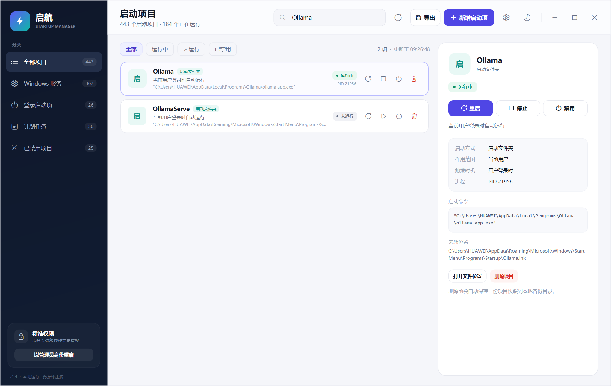
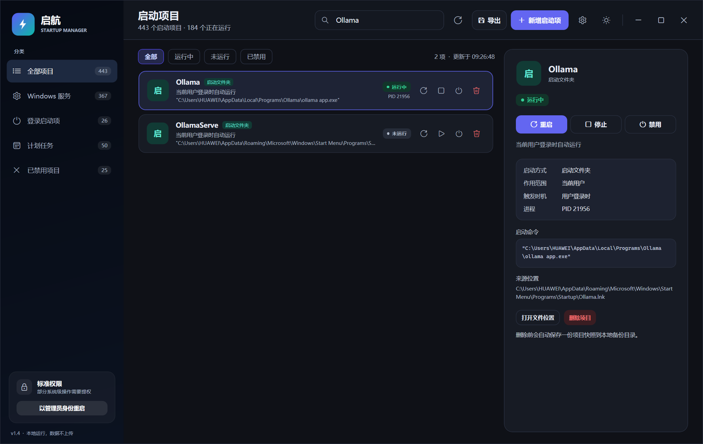
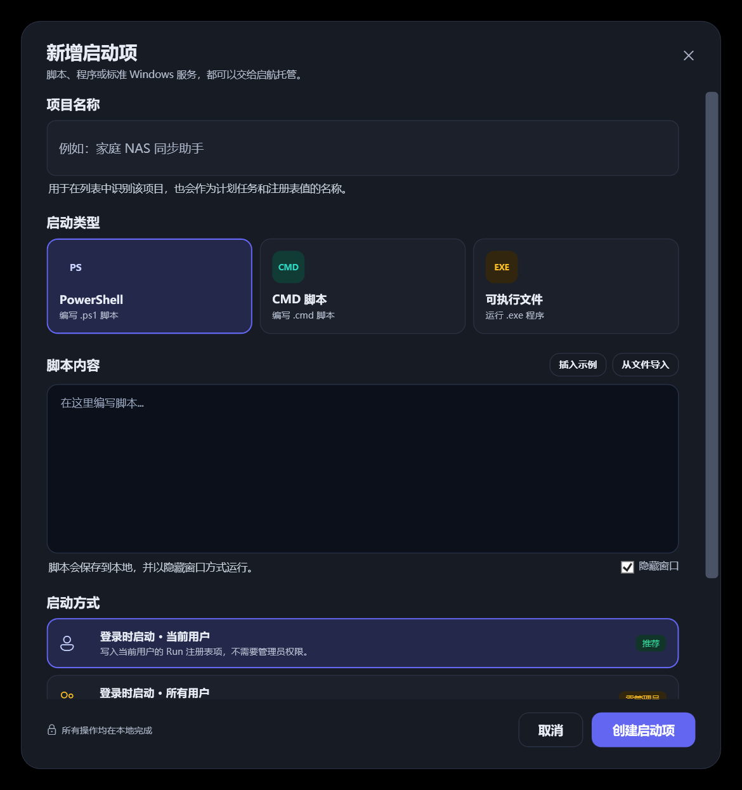
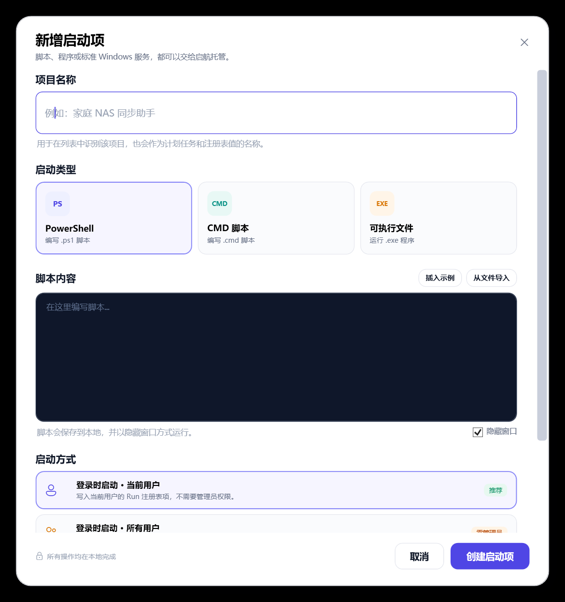
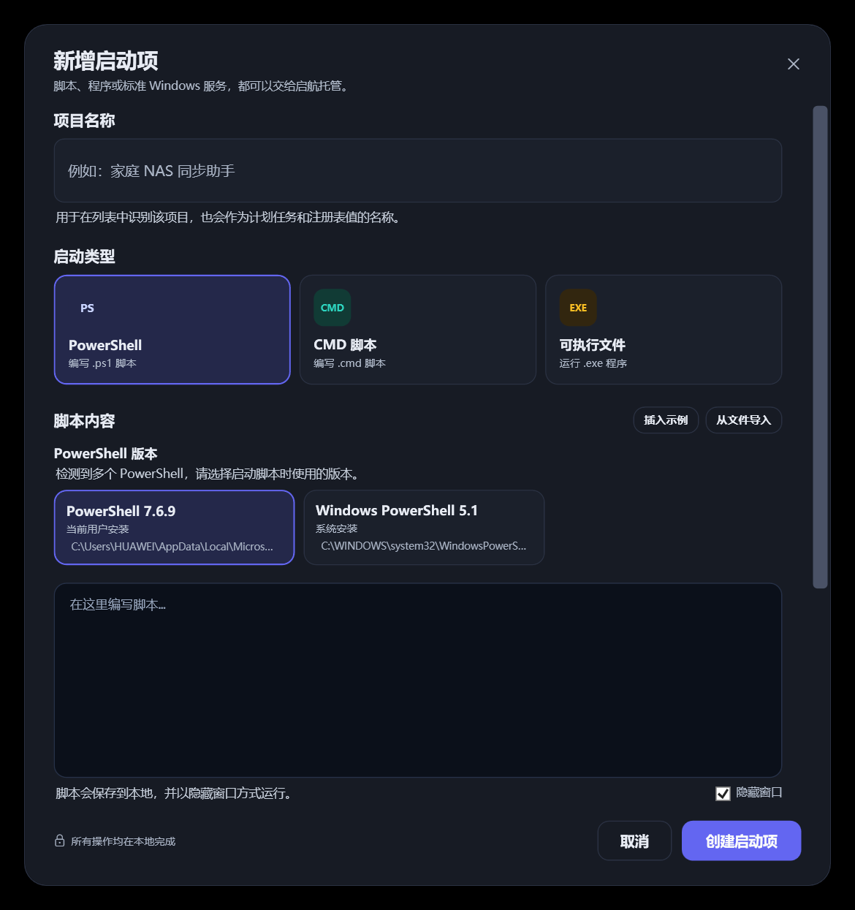
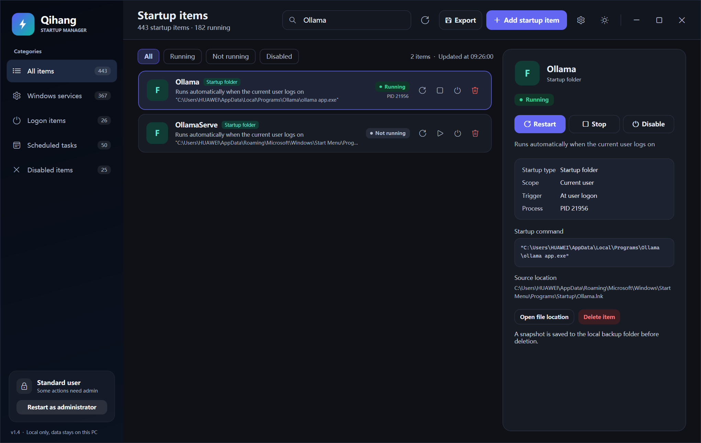
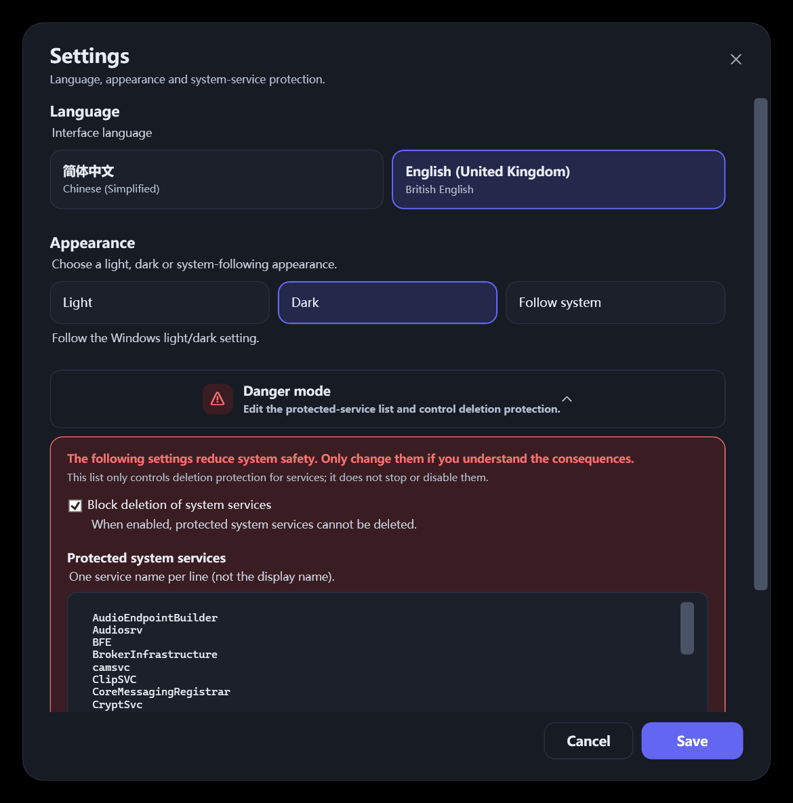
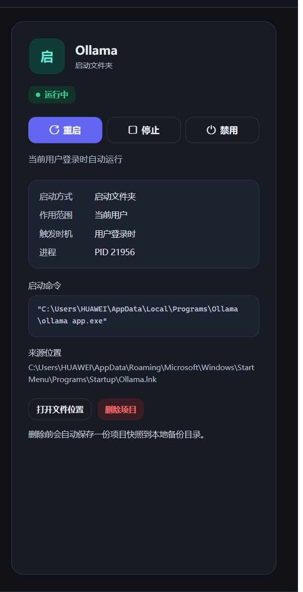

[English](README.en.md) | 简体中文

# 启航 · 开机启动管理器

一个面向 Windows 10/11 的本地启动项管理工具。它把散落在 **Windows 服务、注册表 Run、启动文件夹、计划任务** 里的开机自启动项目集中到一个界面中，并提供停止、重启、启用、禁用、删除、新增、设置、语言切换、亮色/暗黑/跟随系统外观、危险模式保护和 CSV 导出能力。

## 主题预览

浅色模式：



深色模式：



<details>
<summary>深色模式下的新增对话框与确认对话框</summary>




</details>

## 功能

### 1. 统一扫描

启动后会并行读取四类启动来源：

| 来源 | 说明 |
| --- | --- |
| Windows 服务 | 通过 SCM 枚举 Win32 服务，显示启动类型、状态、PID、映像路径 |
| 注册表启动项 | HKCU/HKLM、Run/RunOnce、32 位 Wow6432Node、Policies 启动项 |
| 启动文件夹 | 当前用户与所有用户的 Startup 文件夹，解析 `.lnk` 快捷方式 |
| 计划任务 | 只展示带“开机”或“登录”触发器的任务，保留任务路径与执行账户 |

列表会显示运行状态、PID、启动方式、作用范围、是否需要管理员权限，并支持名称/命令/路径搜索和状态筛选。

### 2. 停止 / 结束

- **Windows 服务**：通过服务控制管理器发送停止请求，等待状态变为 Stopped，而不是粗暴结束 `svchost.exe`。
- **计划任务**：调用任务计划程序停止当前运行实例。
- **注册表 / 启动文件夹项目**：通过进程路径、脚本命令行匹配关联进程，再结束进程树。

### 3. 重启

- **服务**：先停止、等待停止完成，再启动并等待进入 Running。
- **计划任务**：结束正在运行的实例后重新触发。
- **普通启动项**：结束关联进程后重新执行配置的命令或快捷方式。

### 4. 启用 / 禁用启动

- **Windows 服务**：将服务启动类型改为“禁用”，不会立即结束当前进程；重新启用时优先恢复原来的启动类型（自动/手动）。原始启动类型会记录在本地，程序重启后仍可恢复。
- **注册表 Run**：写入 `Explorer\StartupApproved\Run` / `Run32` 的启用/禁用状态，与任务管理器行为一致。
- **启动文件夹项目**：写入 `Explorer\StartupApproved\StartupFolder`，下次登录不再自动运行。
- **计划任务**：直接设置任务的 `Enabled` 状态，关闭或恢复触发器；当前正在运行的实例不会被强制结束。
- **关键 Windows 服务**：禁止禁用，避免误操作导致系统无法启动；如果该类服务已被外部禁用，仍允许通过本工具重新启用。
- **RunOnce / 组策略启动项**：按钮会禁用并提示原因，因为 Windows 不保证 StartupApproved 对它们生效。

禁用是“下次启动时不再自动运行”的语义，不会自动结束当前正在运行的进程。

### 5. 删除

- 删除注册表启动值、启动文件夹文件、计划任务或 Windows 服务。
- 删除前会在本地保存一份 JSON 快照，方便排查。
- Windows 服务删除需要输入服务名确认；系统关键服务内置保护名单，禁止误删。
- 计划任务路径位于 `\Microsoft\` 下的系统任务也会要求输入任务名确认。

### 6. 新增启动项



支持三种内容类型：

- **PowerShell 脚本**：在编辑器中编写，或从 `.ps1` 导入；保存为 UTF-8 BOM 脚本文件。
- **CMD 脚本**：编写或导入 `.cmd`/`.bat`。
- **可执行文件**：选择 `.exe`，可附加启动参数。

如果同时检测到多个 PowerShell（例如 Windows PowerShell 5.1 与 PowerShell 7.x），选择 PowerShell 类型后会显示版本选择卡片：



- 会显示检测到的版本、安装范围和可执行文件路径。
- “当前用户”启动方式可以使用当前用户安装的 PowerShell Core。
- “所有用户”和“系统启动任务”只显示系统级安装，避免登录到其他账户或 SYSTEM 会话时找不到用户目录下的 `pwsh.exe`。
- CMD / EXE 类型不显示该选择区；只有一种 PowerShell 时自动使用，不额外打扰。

支持四种启动方式：

| 启动方式 | 落点 | 权限 |
| --- | --- | --- |
| 登录时启动 · 当前用户 | HKEY_CURRENT_USER `Run` | 普通用户 |
| 登录时启动 · 所有用户 | HKEY_LOCAL_MACHINE `Run` | 管理员 |
| 系统启动任务 · SYSTEM | 任务计划程序开机触发器 | 管理员 |
| 安装为 Windows 服务 | SCM 创建自动启动服务 | 管理员，仅 EXE |

> 普通桌面程序通常不实现 Windows 服务接口，安装为服务后可能报 1053。此类程序应选择“登录时启动”或“系统启动任务”。

### 7. 设置菜单

点击 Header 右侧的齿轮按钮打开设置：


- **语言**：简体中文 / English (United Kingdom)，使用英式拼写（Minimise、Maximise 等）；切换后主界面、对话框、操作提示立即更新。
- **显示模式**：亮色模式 / 暗黑模式 / 跟随系统。跟随系统读取 `AppsUseLightTheme`，系统外观改变时同步刷新。
- **危险模式**：默认折叠，展开后可编辑受保护系统服务名单，并设置是否拒绝删除系统服务。

英文界面（English (United Kingdom)）：



危险模式展开后：



- 名单每行一个**服务名**（不是显示名），修改后点击保存生效。
- **拒绝删除系统服务** 默认开启；关闭后仍保留保护标记，但允许通过二次输入服务名确认删除。
- 默认名单会保护 RpcSs、DcomLaunch、Winmgmt、EventLog、WinDefend 等关键服务。
- 危险设置只影响删除保护，不会停止、禁用或修改任何服务。

### 8. 深色 / 浅色模式

顶部 Header 右侧（窗口控制按钮左侧）有主题切换按钮，图标在月亮/太阳之间切换：

- 颜色全部通过 `DynamicResource` 引用，切换时不需要重启窗口。
- 主界面、列表、详情面板、Toast、`AddEntryWindow`、`SettingsWindow`、`ConfirmDialog` 会同步换肤。
- 详情面板的字段名、描述、命令、来源等小字号文字均使用亮色主题文字（深色模式下最低对比度约 6:1），不会出现黑字。
- 主题偏好保存到 `%LOCALAPPDATA%\StartupManager\settings.json`，下次启动自动应用。
- 深色主题使用深灰蓝背景（`#0F1117` / `#171B24`），避免纯黑和纯白造成高对比度疲劳。
- 设置中的“跟随系统”会跟随 Windows 的亮色/暗黑设置。

深色详情面板逐行对比度检查：



### 9. CSV 导出

点击 Header 中的 **“导出”**：

- 弹出 Windows 原生 `SaveFileDialog`，默认文件名 `StartupItems_yyyyMMdd_HHmmss.csv`。
- 导出**当前筛选/搜索后界面显示的项目**，不是全量数据。
- 字段：名称、分类、状态、是否需管理员、命令行、文件路径、启动方式。
- 使用 **UTF-8 with BOM** 写入，Excel 打开中文不乱码；逗号、引号和换行会正确转义。
- 导出成功后使用应用内 Toast 提示导出数量。

## 权限说明

应用默认以**标准权限**启动：

- 可查看全部项目，可管理 HKCU 启动项。
- Windows 服务、HKLM 启动项、系统级计划任务需要管理员权限。
- 左下角会显示当前权限。点击 **“以管理员身份重启”** 会请求 UAC，提权后全部功能解锁。
- 也可以直接右键 `StartupManager.exe` → **以管理员身份运行**。

## 安全设计

- 关键 Windows 服务保护名单默认内置（RpcSs、DcomLaunch、LSM、Winmgmt、EventLog、Schedule、WinDefend、wscsvc 等），可在“设置 → 危险模式”中编辑。
- “拒绝删除系统服务”默认开启；关闭后仍要求二次输入服务名确认。
- Windows 服务删除必须再次输入服务名；系统级计划任务删除需要输入任务名。
- 删除前保存项目快照到 `%LOCALAPPDATA%\StartupManager\Backups`。
- 操作日志写入 `%LOCALAPPDATA%\StartupManager\Logs`。
- 不会自动执行启动项里的命令；所有启动/重启都必须由用户点击触发。
- 所有数据都在本地处理，不上传网络。

## 运行

### 直接运行

在右侧的`Releases`页面中下载最新的稳定版，然后在文件资源管理器中双击即可运行。

系统要求：`Microsoft Windows 10/11 64位`
⚠️ 未验证是否能在 Windows on ARM (WOA) 的 Prism 转译层中的运行情况。

本仓库的 `release` 是 **win-x64 自包含单文件版本**，不需要额外安装 .NET；首次启动会解压运行时，可能需要等待几秒。重新构建 framework-dependent 版本时，才需要安装 **.NET 10 Desktop Runtime**。

### 从源码运行

```powershell
dotnet run --project src/StartupManager/StartupManager.csproj
```

### 构建与发布

```powershell
dotnet build StartupManager.slnx -c Release
dotnet publish src/StartupManager/StartupManager.csproj -c Release -r win-x64 --self-contained true -p:PublishSingleFile=true -p:IncludeAllContentForSelfExtract=true -o release
```

自包含单文件使用 `IncludeAllContentForSelfExtract=true`，首次启动会把运行时解压到临时目录，避免 WPF 在单文件模式下出现空白窗口。发布产物仍只有一个 `release/StartupManager.exe`。若遇到单文件空白窗口，先删除 `src/StartupManager/bin`、`src/StartupManager/obj` 和旧发布目录，再重新发布。

### 版本与构建信息（单一配置源）

应用名称、版本号、发布者、版权、运行时与发布参数全部集中在 **`build/app.props`**，改这一个文件即可，不需要再改代码或 XAML：

```xml
<AppDisplayName>启航 · 开机启动管理器</AppDisplayName>
<AppProductName>启航</AppProductName>
<AppTaglineZh>本地运行，数据不上传</AppTaglineZh>
<AppTaglineEn>Local only, data stays on this PC</AppTaglineEn>
<AppReleaseChannel>prerelease</AppReleaseChannel>  <!-- stable / prerelease / dev / nightly -->
<AppVersion>1.5.0-rc1</AppVersion>        <!-- 时点版本，不包含 -BUILDYYWW -->
<AppBuildNumber>BUILD2646</AppBuildNumber><!-- 仅 stable/prerelease 追加；YYWW 为 ISO 年/周 -->
<AppFileVersion>1.5.0.0</AppFileVersion>  <!-- 必须是纯数字 -->
<AppCopyright>Copyright © 2026 Xiayue. Apache License 2.0.</AppCopyright>
<AppCompany>Xiayue</AppCompany>
<AppRepositoryUrl>https://github.com/tianyuzpr/startup-manager</AppRepositoryUrl>
<AppMinimumWindows>Windows 10 1607 (build 14393) or later, x64</AppMinimumWindows>
```

版本命名规则：

| 类型 | 格式 | 是否带 build 编号 |
|---|---|---|
| 稳定版 | `vX.Y.Z-BUILDYYWW` | 是 |
| 预发布 | `vX.Y.0-rcZ-BUILDYYWW` | 是 |
| 夜间构建 | `YYwWWdDZ.NIGHTLY` | 否 |
| 开发版 | `YYwWWdDZ` | 否 |

自动构建 workflow 支持 `nightly` 与 `dev` 两个 channel。计算当天的 Z 时，会同时读取已有的开发版（`YYwWWdDZ`）和夜间构建（`YYwWWdDZ.NIGHTLY`）标签，取最大字母后顺延一位；因此如果当天已有开发版 `26w46d6a`，夜间构建会得到 `26w46d6b.NIGHTLY`，不会再复用同一个 Z。

生效方式：

- **编译期**：`StartupManager.csproj` 导入该文件，程序集名称、标题、产品、版本、公司、版权都来自这里，文件属性里的版本随之变化。`stable` / `prerelease` 会自动把 `AppVersion` 和 `AppBuildNumber` 拼成完整版本；`dev` / `nightly` 不追加 build 编号。
- **运行期**：同一文件作为嵌入资源打入程序，`Services/AppInfo.cs` 读取程序集信息后驱动界面：窗口标题、侧栏品牌名、底部版本行（`v1.5.0-rc1-BUILD2646  ·  本地运行，数据不上传`）、新增对话框名称、提权提示、计划任务作者说明等。
- 修改后直接重新 `dotnet build` / `dotnet publish` 即可，无需改任何 XAML 或 C# 文件。

> `Services/ScheduledTaskManager.cs` 里的 `<Task version="1.4">` 是 Windows 任务计划 XML 架构版本，不属于应用版本，请勿修改。

## 目录结构

```text
build/app.props         # 版本、名称、发布者等全部可配置信息（唯一修改点）
src/StartupManager/
├─ Models/             # 启动项模型、操作请求/结果
├─ Services/           # 扫描、操作、注册表、服务、计划任务、进程探测、CSV、保护名单
├─ Localization/       # 中英文文本、LocExtension、运行时切换
├─ Themes/             # LightTheme / DarkTheme 资源字典与 ThemeManager
├─ Interop/            # SCM/进程 API P/Invoke
├─ ViewModels/         # 主界面筛选与统计
├─ Dialogs/            # 新增启动项、设置、确认操作
├─ App.xaml            # 全局样式与主题资源入口
└─ MainWindow.xaml     # 主界面
tools/generate-icon.ps1 # 重新生成应用图标
docs/                   # 截图
```

## 技术实现

- .NET 10 + WPF，无第三方 UI 框架。
- 主题系统：`Themes/LightTheme.xaml` 与 `Themes/DarkTheme.xaml` 维护完全相同的资源键，所有界面颜色通过 `DynamicResource` 引用；切换时只替换 `Application.Resources.MergedDictionaries` 中的主题字典。`ThemeMode.System` 读取 `AppsUseLightTheme` 并监听系统偏好变化。
- 语言系统：`Localization/LocalizationManager.cs` 维护中文源字符串与英式英语映射，`LocExtension` 让 XAML 通过 `{loc:Loc ...}` 绑定到索引器，切换语言时所有绑定即时更新；偏好保存在 `%LOCALAPPDATA%\StartupManager\language.json`。
- 系统服务保护：`Services/SystemServiceProtection.cs` 加载默认名单，并在“危险模式”保存后写入 `%LOCALAPPDATA%\StartupManager\protection.json`；`ManagedEntry.CanDelete` 与删除动作同时检查“拒绝删除系统服务”设置。
- 服务控制使用 `advapi32.dll` P/Invoke（OpenSCManager/OpenService/StartService/ControlService/DeleteService/CreateService）。
- 启用/禁用：注册表与启动文件夹写 `Explorer\StartupApproved`，计划任务使用 `IRegisteredTask.Enabled`，服务使用 `ChangeServiceConfig`。原服务启动类型保存在 `%LOCALAPPDATA%\StartupManager\service-start-types.json`。
- 进程命令行通过 `System.Management` 的 `Win32_Process` 获取，用于脚本型启动项的运行状态与进程匹配。
- 计划任务通过 Task Scheduler COM（`Schedule.Service`）读取与操作，并通过 `schtasks.exe /Create /XML` 创建 SYSTEM 开机任务。
- 快捷方式通过 `WScript.Shell` COM 解析。
- PowerShell 主机由 `Services/PowerShellHostDetector.cs` 检测：扫描系统安装目录、PATH、当前用户 WindowsApps 别名，并读取主机版本；创建启动项时使用用户选择的主机。
- CSV 导出由 `Services/CsvExporter.cs` 实现，使用 `UTF8Encoding(encoderShouldEmitUTF8Identifier: true)`。

## 已知限制

- 不管理内核驱动，只管理 Win32 服务。
- Windows 服务的显示名和描述来自操作系统，英文界面下仍可能显示为系统语言；应用自身的标签、按钮和提示会切换。
- 危险模式只控制删除保护，不会停止或禁用服务；关闭“拒绝删除”后仍需要二次输入服务名。
- 计划任务中使用 COM Handler 的任务只能显示和删除，不能通过本工具直接运行。
- `RunOnce` 和组策略启动项无法可靠通过 StartupApproved 禁用，界面会禁用该操作并提示原因。
- 禁用服务只修改启动类型，当前已运行的进程不会被立即结束。
- 运行状态依赖进程路径/命令行匹配。使用自定义启动器包装的脚本可能无法准确识别。
- 删除 Windows 服务是永久操作；关键服务会被保护，但非关键服务请确认后再删。
- 界面支持简体中文与英式英语，可在设置中切换。
